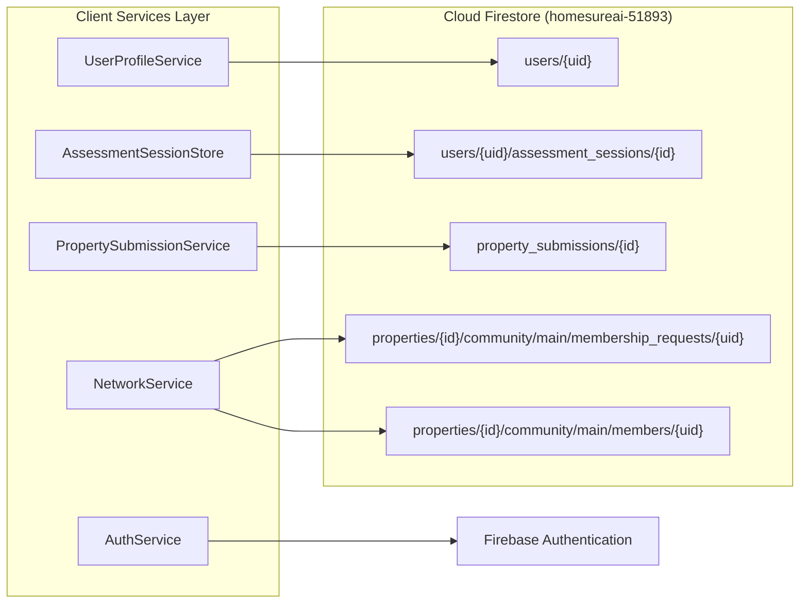

# HomeSure AI — Backend Architecture Audit

**Document Identifier:** `HOMESURE_BACKEND_ARCHITECTURE.md`  
**Audit Date:** November 9, 2026  
**Auditor:** Antigravity AI Engineering  
**Application Root:** `c:\Program Files\BlackMatter\Homesure`  

---

## 1. Backend Paradigm & Infrastructure

HomeSure AI implements a **Serverless Backend-as-a-Service (BaaS)** architecture centered on **Google Firebase**. 

* **Firebase Project ID:** `homesureai-51893` ([`.firebaserc#L3`](file:///c:/Program%20Files/BlackMatter/Homesure/.firebaserc#L3))
* **Primary Gateway:** Direct client-to-database communication via the Cloud Firestore native SDK (bypassing custom HTTP REST middleware).
* **Serverless Compute:** Firebase Cloud Functions v2 in TypeScript ([`functions/`](file:///c:/Program%20Files/BlackMatter/Homesure/functions)).
* **Local Emulation:** Configured in [`firebase.json`](file:///c:/Program%20Files/BlackMatter/Homesure/firebase.json) for Authentication (port `9099`) and Firestore (port `8180`).

---

## 2. Service Organization & Frontend-to-Backend Mapping

Rather than communicating through traditional REST or GraphQL controllers, the frontend interacts with backend services through specialized Dart service gateways:



### Detailed Service Responsibilities

| Service Name | File Path | Firestore Collection / Auth Target | Operation & Protocol |
| :--- | :--- | :--- | :--- |
| **`AuthService`** | `lib/features/auth/services/auth_service.dart` | Firebase Auth | Email/Password login, registration, password resets. |
| **`UserProfileService`** | `lib/features/auth/services/user_profile_service.dart` | `users/{userId}` | Read/write language preferences, display name, and onboarding state. |
| **`AssessmentSessionStore`** | `lib/core/assessment/assessment_session_store.dart` | `users/{uid}/assessment_sessions/{assessmentId}` | Continuous read/write synchronization of in-progress assessment responses. |
| **`PropertySubmissionService`** | `lib/features/property_submission/services/property_submission_service.dart` | `property_submissions/{submissionId}` | Submits unlisted project reviews; streams user submission statuses. |
| **`NetworkService`** | `lib/features/network/services/network_service.dart` | `properties/{id}/community/main/membership_requests/{uid}` | Submits RWA community membership join requests; checks approval status. |
| **`PropertyRepository`** | `lib/features/property/services/property_repository.dart` | *Local In-Memory* | Currently detached from Firestore; serves static in-memory properties. |

---

## 3. Serverless Compute & Cloud Functions Status

* **Source Directory:** [`functions/`](file:///c:/Program%20Files/BlackMatter/Homesure/functions)
* **Configuration:** TypeScript 5.3, `firebase-functions` v2, `firebase-admin` v12.
* **Entry Point:** [`functions/src/index.ts`](file:///c:/Program%20Files/BlackMatter/Homesure/functions/src/index.ts)
* **Audit Finding:**
  ```typescript
  import {setGlobalOptions} from "firebase-functions";
  setGlobalOptions({maxInstances: 10});
  // export const helloWorld = onRequest(...)
  ```
  **Current Status: Unimplemented Starter Boilerplate.** No background triggers, document event listeners, OCR extractors, or administrative approval functions are implemented. All business calculations currently execute on client devices.

---

## 4. File Storage & Evidence Management Architecture

* **Identified Gap:** The repository does **not** declare `firebase_storage` in [`pubspec.yaml`](file:///c:/Program%20Files/BlackMatter/Homesure/pubspec.yaml), nor are Cloud Storage security rules present in `firebase.json`.
* **Current Behavior:**
  * When a user attaches evidence via camera, photo library, or PDF picker, the file path is stored as a local filesystem string (`Evidence.filePath`).
  * Evidence records are validated and summarized locally in memory (`AssessmentEvidenceSummary`).
  * Files are **not uploaded to cloud storage buckets**, meaning evidence attached on one device will not synchronize to another device or be accessible by administrative reviewers.

---

## 5. Security & Access Control

Security is enforced at the database layer via declarative rules in [`firestore.rules`](file:///c:/Program%20Files/BlackMatter/Homesure/firestore.rules):

1. **Authentication Gate:** Requests must possess a valid Firebase token (`request.auth != null`).
2. **Owner-Scoped Privacy:**
   * Users can only read and write their own profile (`request.auth.uid == userId`).
   * Assessment sessions are private subcollections under the user's document.
   * Assessment session deletion is globally prohibited (`allow delete: if false`).
3. **Strict Schema Constraints on Submissions:**
   * Every document written to `property_submissions` must match an exact schema with strict key checks (`keys().hasOnly([...])`).
   * String lengths are bounded (Property Name: 1-200 chars; Locality: 1-200 chars; City: 1-100 chars).
   * Status must strictly initialize as `pending_review`.
   * Creation timestamp must equal request time (`createdAt == request.time`).
4. **Community Membership Gating:**
   * Membership requests require `userId == request.auth.uid`.
   * Relationship must be one of `['owner', 'tenant', 'familyMember']`.
   * Approved member records (`properties/{id}/community/main/members/{uid}`) can only be created by trusted server code (`allow create, update, delete: if false`).
5. **Default Deny:** The ruleset concludes with an explicit fallback deny rule (`match /{document=**} { allow read, write: if false; }`).
