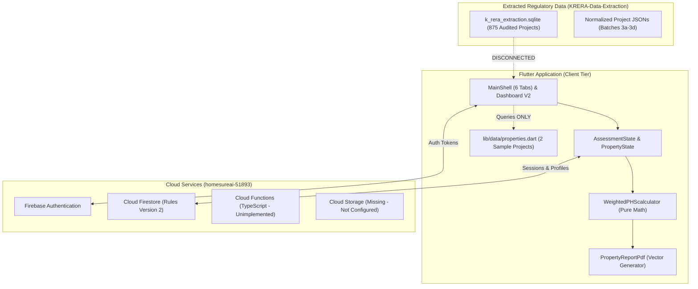

# HomeSure AI — Current State Master Audit Report

**Document Identifier:** `HOMESURE_CURRENT_STATE_MASTER_REPORT.md`  
**Audit Date:** November 9, 2026  
**Auditor:** Antigravity AI Engineering  
**Application Root:** `c:\Program Files\BlackMatter\Homesure`  
**Repository Branch:** `main` (commit `6db7592`: *"Prepare HomeSureAI for engineering collaboration"*)

---

## 1. Executive Summary

HomeSure AI has established a **solid, mathematically sound core foundation** for property health scoring, evidence verification, and multi-lingual reporting. The application's scoring engine, questionnaire flow, and vector PDF generators are production-grade and backed by **879 automated unit and widget tests**.

However, the application currently suffers from **subsystem disconnects and runtime debt** that hinder production rollout:
1. **The Ingestion Disconnect:** A rich, audited dataset of **875 Karnataka RERA projects** sits in a local SQLite database (`KRERA-Data-Extraction/data/k_rera_extraction.sqlite`), completely detached from the Flutter app's search UI, which is limited to 2 hardcoded sample properties.
2. **The Cloud Evidence Gap:** Attached evidence (photos, PDFs) is stored only as local device filesystem paths (`Evidence.filePath`). No cloud storage synchronization (`firebase_storage`) is implemented.
3. **Navigation Dead-Ends:** The primary navigation shell (`MainShell`) contains static "Coming Soon" tabs for features that are already implemented in the codebase.
4. **Configuration Traps:** `kUseFirebaseEmulators = true` requires local emulator daemons to run, and the production Android manifest lacks an explicit `INTERNET` permission declaration.

---

## 2. Master Document Map

This master audit is supported by 10 comprehensive domain reports located in [`docs/audit/`](file:///c:/Program%20Files/BlackMatter/Homesure/docs/audit):

| # | Audit Deliverable | Document Scope & Key Findings |
| :---: | :--- | :--- |
| **01** | [**`HOMESURE_EXISTING_APP_OVERVIEW.md`**](file:///c:/Program%20Files/BlackMatter/Homesure/docs/audit/HOMESURE_EXISTING_APP_OVERVIEW.md) | Mission, user personas, high-level capabilities, tech stack (Flutter 3.47.9 / Dart 3.13.7 / Firebase / SQLite), and build configurations. |
| **02** | [**`HOMESURE_END_TO_END_USER_JOURNEY.md`**](file:///c:/Program%20Files/BlackMatter/Homesure/docs/audit/HOMESURE_END_TO_END_USER_JOURNEY.md) | Granular breakdown of all 15 screens, route transitions, user interactions, form validations, loading states, and state machines. |
| **03** | [**`HOMESURE_FEATURE_INVENTORY.md`**](file:///c:/Program%20Files/BlackMatter/Homesure/docs/audit/HOMESURE_FEATURE_INVENTORY.md) | Complete inventory of 24 features classified into operational tiers (Fully implemented, UI only, Backend only, Planned). |
| **04** | [**`HOMESURE_FRONTEND_ARCHITECTURE.md`**](file:///c:/Program%20Files/BlackMatter/Homesure/docs/audit/HOMESURE_FRONTEND_ARCHITECTURE.md) | Component architecture, state management (`AssessmentState`, `PropertyState`), styling tokens, multi-language localization, and architectural duplications. |
| **05** | [**`HOMESURE_BACKEND_ARCHITECTURE.md`**](file:///c:/Program%20Files/BlackMatter/Homesure/docs/audit/HOMESURE_BACKEND_ARCHITECTURE.md) | Firebase serverless BaaS, Firestore rules RBAC, TypeScript Cloud Functions status, and evidence storage gaps. |
| **06** | [**`HOMESURE_DATABASE_SCHEMA.md`**](file:///c:/Program%20Files/BlackMatter/Homesure/docs/audit/HOMESURE_DATABASE_SCHEMA.md) | Firestore collections (`users`, `assessment_sessions`, `property_submissions`, `community`), composite indexes, and SQLite K-RERA tables. Includes Mermaid ER diagram. |
| **07** | [**`HOMESURE_INTEGRATIONS.md`**](file:///c:/Program%20Files/BlackMatter/Homesure/docs/audit/HOMESURE_INTEGRATIONS.md) | Complete audit of SDKs (Firebase, Image/File pickers, PDF/Printing, Google Fonts) and identified missing integrations (Gemini, Payments, Maps). |
| **08** | [**`HOMESURE_UI_UX_AUDIT.md`**](file:///c:/Program%20Files/BlackMatter/Homesure/docs/audit/HOMESURE_UI_UX_AUDIT.md) | Interaction friction analysis: 3-screen onboarding fatigue, navigation dead-ends, non-functional city search, and terminological inconsistency. |
| **09** | [**`HOMESURE_BUILD_AND_DEPLOYMENT.md`**](file:///c:/Program%20Files/BlackMatter/Homesure/docs/audit/HOMESURE_BUILD_AND_DEPLOYMENT.md) | Gradle/NDK build pipeline, release signing keystore risks, Android manifest permissions audit, and environment flags. |
| **10** | [**`HOMESURE_TECHNICAL_DEBT_AND_ISSUES.md`**](file:///c:/Program%20Files/BlackMatter/Homesure/docs/audit/HOMESURE_TECHNICAL_DEBT_AND_ISSUES.md) | Prioritized register of 17 bugs, security vulnerabilities, and architectural bottlenecks ranked from Critical to Low. |

---

## 3. High-Level Architecture & Ecosystem State

---

## 4. Key Takeaways for the Upcoming Revamp

1. **Import the 875 K-RERA Projects:** Connecting the local SQLite extraction pipeline to `PropertySearchScreen` will instantly elevate the app from a prototype with 2 hardcoded apartments to a real, auditable platform covering Bengaluru Urban.
2. **Unify the Property Domain Models:** Retire `legacy.Property` and `PropertyAdapter`, making `feature.Property` the single domain model across the entire application.
3. **Eliminate Navigation Placeholders:** Connect the "Health" and "AI" tabs in `MainShell` to the existing, fully implemented `PropertyHealthRecordScreen` and `SureBotScreen`.
4. **Implement Cloud Storage:** Integrate `firebase_storage` so attached evidence photos and PDFs are securely stored in the cloud.
5. **Harden Build Configurations:** Add `<uses-permission android:name="android.permission.INTERNET"/>` to `src/main/AndroidManifest.xml` and configure production release signing.
