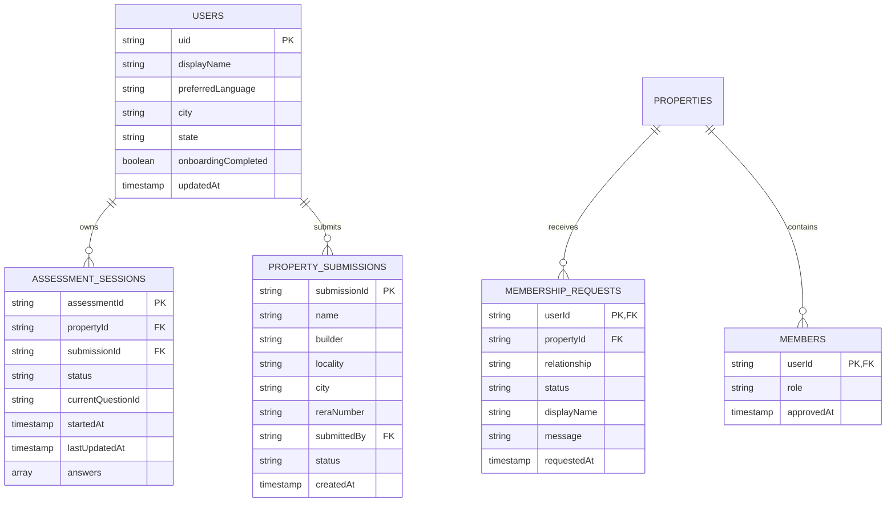

# HomeSure AI — Database Schema & Data Model Audit

**Document Identifier:** `HOMESURE_DATABASE_SCHEMA.md`  
**Audit Date:** November 9, 2026  
**Auditor:** Antigravity AI Engineering  
**Application Root:** `c:\Program Files\BlackMatter\Homesure`  

---

## 1. Database Technologies

The HomeSure ecosystem currently operates across two distinct database tiers:
1. **Cloud Tier (NoSQL):** **Google Cloud Firestore** (document-store database powering runtime user state, assessment sessions, and submissions).
2. **Ingestion Tier (Relational):** **SQLite 3** (`KRERA-Data-Extraction/data/k_rera_extraction.sqlite`, storing the 875 official Karnataka RERA projects and audit logs).

---

## 2. Cloud Firestore Schema (Production BaaS)

---

### Collection 1: `users/{userId}`
* **Document ID:** Firebase Auth UID (`request.auth.uid`).
* **Purpose:** Stores user profile attributes and onboarding flags.
* **Fields:**
  | Field Name | Data Type | Nullable | Description / Constraints |
  | :--- | :--- | :---: | :--- |
  | `uid` | String | No | Firebase User ID. |
  | `displayName` / `name` | String | Yes | User's preferred name. |
  | `preferredLanguage` | String | Yes | Language code (`en`, `kn`, `hi`, `te`, `ta`, `ml`). Default: `en`. |
  | `city` | String | Yes | Primary city chosen during onboarding (e.g., `Bengaluru`). |
  | `state` | String | Yes | State corresponding to city (e.g., `Karnataka`). |
  | `onboardingCompleted` | Boolean | No | Gatekeeper flag unlocking the main shell. Default: `false`. |
  | `updatedAt` | Timestamp | Yes | Server timestamp of last profile update. |

---

### Collection 2: `users/{userId}/assessment_sessions/{assessmentId}`
* **Document ID:** Generated unique session ID (e.g., `ASSESSMENT_1794229639757218`).
* **Purpose:** Stores live and historical questionnaire responses per property.
* **Composite Index:** `status` ASC, `lastUpdatedAt` DESC ([`firestore.indexes.json#L4-L15`](file:///c:/Program%20Files/BlackMatter/Homesure/firestore.indexes.json#L4-L15)).
* **Fields:**
  | Field Name | Data Type | Nullable | Description / Constraints |
  | :--- | :--- | :---: | :--- |
  | `assessmentId` | String | No | Unique session key. |
  | `propertyId` | String | No | Associated property ID (e.g., `P001` or RERA Reg No). |
  | `submissionId` | String | Yes | Associated crowd-sourced submission ID if applicable. |
  | `status` | String | No | Session state: `in_progress`, `completed`, `abandoned`. |
  | `currentQuestionId` | String | Yes | Last active question pointer (e.g., `LEGAL_OC`). |
  | `startedAt` | Timestamp | No | Session start time. |
  | `lastUpdatedAt` | Timestamp | No | Last response timestamp. |
  | `answers` | Array of Maps | No | List of answer maps: `[{ questionId: string, response: string }]`. |

---

### Collection 3: `property_submissions/{submissionId}`
* **Document ID:** Auto-generated Firestore document ID.
* **Purpose:** Stores user-submitted unlisted real estate projects awaiting administrative review.
* **Composite Index:** `submittedBy` ASC, `createdAt` DESC ([`firestore.indexes.json#L18-L29`](file:///c:/Program%20Files/BlackMatter/Homesure/firestore.indexes.json#L18-L29)).
* **Fields:**
  | Field Name | Data Type | Nullable | Description / Constraints |
  | :--- | :--- | :---: | :--- |
  | `submissionId` | String | No | Document ID. |
  | `name` | String | No | Property name (1-200 chars). |
  | `builder` | String | Yes | Developer entity name (max 200 chars). |
  | `locality` | String | No | Locality / Suburb (1-200 chars). |
  | `city` | String | No | City name (1-100 chars). |
  | `reraNumber` | String | Yes | Official RERA registration number (max 100 chars). |
  | `submittedBy` | String | No | Submitting user's UID. Must match `request.auth.uid`. |
  | `status` | String | No | State machine: `pending_review`, `approved`, `rejected`. |
  | `createdAt` | Timestamp | No | Enforced to equal `request.time`. |

---

### Collection 4: `properties/{propertyId}/community/main/membership_requests/{userId}`
* **Document ID:** Requesting user's UID.
* **Purpose:** Inbound resident requests to join a building's community network.
* **Fields:**
  | Field Name | Data Type | Nullable | Description / Constraints |
  | :--- | :--- | :---: | :--- |
  | `userId` | String | No | Requesting user's UID. |
  | `propertyId` | String | No | Target property ID. |
  | `relationship` | String | No | Restricted to: `owner`, `tenant`, `familyMember`. |
  | `status` | String | No | State machine: `pending`, `approved`, `rejected`, `left`. |
  | `displayName` | String | Yes | Applicant name (max 100 chars). |
  | `message` | String | Yes | Optional note to association (max 300 chars). |
  | `requestedAt` | Timestamp | No | Enforced to equal `request.time`. |

---

## 3. SQLite Ingestion Schema (`k_rera_extraction.sqlite`)

Stored locally at `KRERA-Data-Extraction/data/k_rera_extraction.sqlite` (22.2 MB), capturing 875 audited government records:

1. **`extraction_runs`**: Tracks crawling sessions, start/end timestamps, target filters, and exit codes.
2. **`extracted_pages`**: Raw HTML snapshots of search catalogue pagination.
3. **`raw_search_rows` (4,459 records)**: Individual table row extractions from the portal search results. Contains JSON-encoded table cells, promoter names, approval dates, completion timelines, and portal links.
4. **`detail_extraction_checkpoints` (875 records)**: Master state machine for deep project extractions.
   * `project_key` (TEXT, PK): Canonical RERA registration key.
   * `registration_number` (TEXT): RERA registration number.
   * `acknowledgement_number` (TEXT): Application acknowledgement ID.
   * `project_name` (TEXT): Official registered name.
   * `extraction_status` (TEXT): Status (`successful`).
   * `identity_verification_status` (TEXT): Status (`verified`).
   * `payload_sha256` (TEXT): Cryptographic hash of normalized payload.
   * `raw_output_path` / `normalized_output_path`: Relative paths to parsed JSON files.
5. **`detail_extraction_error_logs` (48 records)**: Audit trail of network timeouts and DOM selector retries during extraction.
