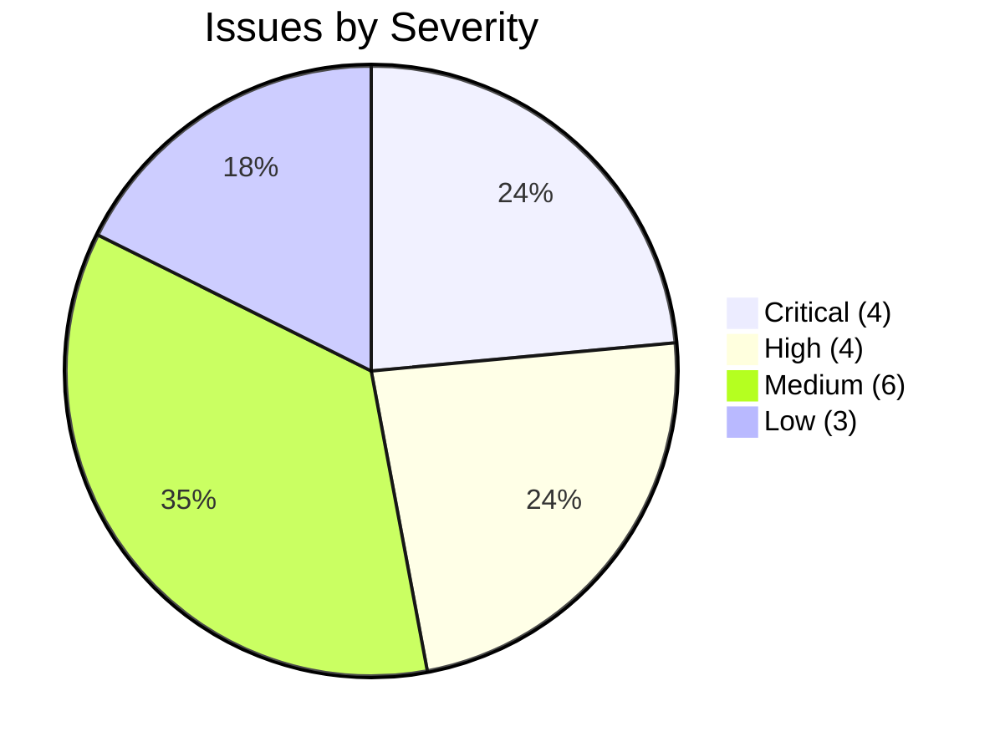

# HomeSure AI — Technical Debt, Vulnerabilities & Known Issues Log

**Document Identifier:** `HOMESURE_TECHNICAL_DEBT_AND_ISSUES.md`  
**Audit Date:** November 9, 2026  
**Auditor:** Antigravity AI Engineering  
**Application Root:** `c:\Program Files\BlackMatter\Homesure`  

---

## 1. Prioritization Framework

Issues are classified by impact on reliability, user experience, scalability, and security:
* **Critical**: Security vulnerabilities, crash risks, broken core functionality, or data loss vectors.
* **High**: Major architectural debt, orphaned implementations, or disconnected subsystems.
* **Medium**: Functional gaps, non-responsive UI controls, or code duplication.
* **Low**: Cosmetic inconsistencies, naming discrepancies, or code cleanliness issues.

---

## 2. Prioritized Issue Register

---

### Tier 1: Critical Severity

#### 1. Missing INTERNET Permission in Production Android Manifest
* **File:** [`android/app/src/main/AndroidManifest.xml`](file:///c:/Program%20Files/BlackMatter/Homesure/android/app/src/main/AndroidManifest.xml)
* **Finding:** `<uses-permission android:name="android.permission.INTERNET"/>` is declared solely in `android/app/src/debug/AndroidManifest.xml`.
* **Impact:** In release mode (`flutter build apk --release`), Android may omit the network socket permission, completely disabling all Firebase Authentication, Firestore, and network calls.

#### 2. Evidence Files Trapped on Local Storage (No Cloud Storage Sync)
* **Files:** [`lib/core/evidence/evidence.dart`](file:///c:/Program%20Files/BlackMatter/Homesure/lib/core/evidence/evidence.dart), [`lib/core/evidence/composite_evidence_capture_service.dart`](file:///c:/Program%20Files/BlackMatter/Homesure/lib/core/evidence/composite_evidence_capture_service.dart)
* **Finding:** The application captures camera photos, gallery screenshots, and PDF documents, but stores only a local filesystem path string (`Evidence.filePath`).
* **Impact:** The app does not utilize `firebase_storage`. Evidence attached on one device is not uploaded to the cloud, cannot be viewed by RWA reviewers or lenders, and is permanently lost if the local device cache is purged.

#### 3. Release APK Configured with Debug Keystore
* **File:** [`android/app/build.gradle.kts#L33`](file:///c:/Program%20Files/BlackMatter/Homesure/android/app/build.gradle.kts#L33)
* **Finding:** The release build block sets `signingConfig = signingConfigs.getByName("debug")`.
* **Impact:** Distributing an APK signed with debug keys exposes applications to tampering, prevents Google Play Store publication, and causes certificate rejection on production Android devices.

#### 4. Active Firebase Emulator Lockout Flag
* **File:** [`lib/main.dart#L22`](file:///c:/Program%20Files/BlackMatter/Homesure/lib/main.dart#L22)
* **Finding:** `const bool kUseFirebaseEmulators = true;` is hardcoded.
* **Impact:** Unless local emulator suites are actively running on the host workstation (ports 9099 and 8180), all authentication requests and Firestore queries will fail to connect.

---

### Tier 2: High Severity

#### 5. Real 875-Project Government Dataset Orphaned from App UI
* **Files:** [`KRERA-Data-Extraction/data/k_rera_extraction.sqlite`](file:///c:/Program%20Files/BlackMatter/Homesure/KRERA-Data-Extraction/data/k_rera_extraction.sqlite), [`lib/data/properties.dart`](file:///c:/Program%20Files/BlackMatter/Homesure/lib/data/properties.dart)
* **Finding:** The repository contains an audited, 22.2 MB SQLite database containing 875 verified Karnataka RERA projects. However, the Flutter property search module (`PropertySearchScreen`) only queries a static file containing 2 hardcoded sample properties ("Casagrand Aquene" and "Prestige Lakeside Habitat").
* **Impact:** 99.8% of available verified project data is inaccessible to the end user.

#### 6. Dual Conflicting Property Domain Models
* **Files:** [`lib/models/property.dart`](file:///c:/Program%20Files/BlackMatter/Homesure/lib/models/property.dart), [`lib/features/property/models/property.dart`](file:///c:/Program%20Files/BlackMatter/Homesure/lib/features/property/models/property.dart), [`lib/features/property/models/property_adapter.dart`](file:///c:/Program%20Files/BlackMatter/Homesure/lib/features/property/models/property_adapter.dart)
* **Finding:** Two competing `Property` classes coexist in the codebase (`legacy.Property` with scalar scores vs. `feature.Property` with structured summaries and addresses).
* **Impact:** Severe maintenance overhead, duplicate type definitions, and fragile adapter transformations across the presentation layer.

#### 7. Navigation Shell Disconnects (Coming Soon Placeholders)
* **File:** [`lib/screens/main_shell.dart#L25-L32`](file:///c:/Program%20Files/BlackMatter/Homesure/lib/screens/main_shell.dart#L25-L32)
* **Finding:** Tabs 2 ("Health") and 3 ("AI") in `MainShell` display placeholder screens, even though complete, functional screen implementations exist in [`PropertyHealthRecordScreen`](file:///c:/Program%20Files/BlackMatter/Homesure/lib/screens/property_health_record_screen.dart) and [`SureBotScreen`](file:///c:/Program%20Files/BlackMatter/Homesure/lib/screens/assessment/surebot_screen.dart).
* **Impact:** Degrades user confidence and conceals completed features.

#### 8. Unimplemented Cloud Functions Backend
* **File:** [`functions/src/index.ts`](file:///c:/Program%20Files/BlackMatter/Homesure/functions/src/index.ts)
* **Finding:** Server-side compute is an unconfigured boilerplate file with commented-out templates.
* **Impact:** No automated validation of user submissions, no server-side PDF archival, no document OCR verification, and no automated notification dispatch.

---

### Tier 3: Medium Severity

#### 9. Non-Functional City Search Input
* **File:** [`lib/screens/onboarding/city_selection_screen.dart#L90`](file:///c:/Program%20Files/BlackMatter/Homesure/lib/screens/onboarding/city_selection_screen.dart#L90)
* **Finding:** `onChanged: (value) { // Search functionality will be added later. }`.
* **Impact:** The search field accepts user keystrokes but filters nothing, giving the appearance of a broken control.

#### 10. Silent Click on Dashboard Timeline
* **File:** [`lib/screens/home_screen_v2.dart#L189`](file:///c:/Program%20Files/BlackMatter/Homesure/lib/screens/home_screen_v2.dart#L189)
* **Finding:** `void _openTimeline() {}` is an empty method stub.
* **Impact:** Tapping timeline actions on the home dashboard produces no reaction.

#### 11. Dual Questionnaire Datasets
* **Files:** [`lib/data/assessment_questions.dart`](file:///c:/Program%20Files/BlackMatter/Homesure/lib/data/assessment_questions.dart) (4 questions), [`lib/data/phs_questions.dart`](file:///c:/Program%20Files/BlackMatter/Homesure/lib/data/phs_questions.dart) (33 questions)
* **Finding:** Dead prototype question data exists alongside production PHS questions.
* **Impact:** Technical debt and dead code cluttering the codebase.

#### 12. Absence of Live LLM / Gemini Integration
* **File:** [`lib/features/surebot/services/property_health_explainer.dart`](file:///c:/Program%20Files/BlackMatter/Homesure/lib/features/surebot/services/property_health_explainer.dart)
* **Finding:** SureBot utilizes deterministic conditional copy templates instead of the generative conversational AI specified in `docs/10_AI_Strategy.md`.
* **Impact:** Inability to answer unscripted homeowner inquiries or parse unstructured title deeds.

#### 13. Deprecated Kotlin Gradle Plugin Build Configuration
* **Files:** [`android/settings.gradle.kts`](file:///c:/Program%20Files/BlackMatter/Homesure/android/settings.gradle.kts), [`android/build.gradle.kts`](file:///c:/Program%20Files/BlackMatter/Homesure/android/build.gradle.kts)
* **Finding:** Build generates deprecation warnings regarding Kotlin Gradle Plugin usage in Firebase dependencies.
* **Impact:** Future Flutter framework upgrades will fail without migration to Built-in Kotlin.

#### 14. Unit Test Microsecond Timestamp Collision
* **File:** [`test/assessment_session_test.dart#L152`](file:///c:/Program%20Files/BlackMatter/Homesure/test/assessment_session_test.dart#L152)
* **Finding:** `DateTime.now().microsecondsSinceEpoch` generates identical session IDs when two sessions start in the same microsecond during automated test execution.
* **Impact:** Causes flaky test failures in continuous integration pipelines.

---

### Tier 4: Low Severity

#### 15. Misleading File Naming
* **File:** [`lib/screens/home_screen.dart`](file:///c:/Program%20Files/BlackMatter/Homesure/lib/screens/home_screen.dart)
* **Finding:** Does not contain a home screen; re-exports `network_home_screen.dart`.
* **Impact:** Developer confusion during onboarding and refactoring.

#### 16. Bengaluru-Centric Acronym Clutter
* **Observation:** Statutory terms (`BESCOM`, `BWSSB`, `e-Khata`, `Fire NOC`) lack explanatory tooltips for out-of-state users.
* **Impact:** Minor cognitive friction for non-Karnataka users.

#### 17. Unmanaged Global Singletons
* **Files:** `PropertyState.instance`, `AssessmentState.instance`, `AppLocaleController.instance`
* **Finding:** State singletons are accessed directly rather than injected via `InheritedWidget` or dependency containers.
* **Impact:** Makes component isolation and widget unit testing more difficult.
