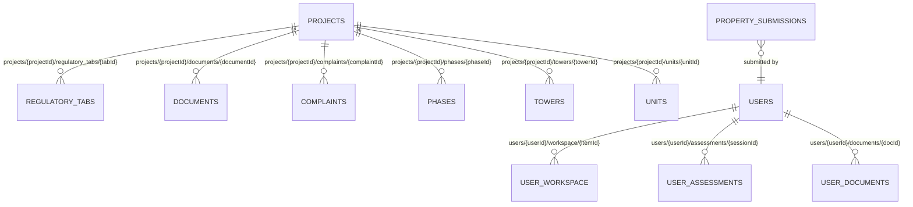

# HomeSure Phase 1 — Canonical Firestore Schema Specification (`FIRESTORE_SCHEMA_SPECIFICATION.md`)

**Date:** 2026-11-10  
**Target Firebase Project:** `homesureai-51893` (`asia-south1`, `FIRESTORE_NATIVE`)  
**Schema Version:** `1.0.0`

---

## 1. Core Design Principles

1. **Deterministic, Collision-Free Document IDs**:
   - Every K-RERA project has a unique `project_key` (`REG::<registration_number>`, e.g., `REG::PRM/KA/RERA/1251/446/PR/171010/000003`).
   - Because Firestore document IDs cannot contain forward slashes (`/`), the canonical Firestore document ID `projectId` is generated deterministically by replacing `::` and `/` with underscores (`_`) and stripping unsafe characters:
     - Example: `REG::PRM/KA/RERA/1251/446/PR/171010/000003` -> `REG_PRM_KA_RERA_1251_446_PR_171010_000003`
   - Project names are **never** used as document IDs.
2. **Strict Separation of Summary Catalogue Data vs. Deep Regulatory Data**:
   - Searching and listing projects in `PropertySearchScreen` only reads the root `projects/{projectId}` document (~3–6 KB per document).
   - Opening `PropertyDetailsScreen` reads `projects/{projectId}` plus on-demand subcollections (`regulatory_tabs`, `documents`, `complaints`, `phases`, `towers`, `units`).
3. **Preservation of All Six `ObservationState` Values**:
   - Every tab, unlinked DOM pane, section, field, and document preserves its exact `ObservationState`:
     - `present_with_data`
     - `present_empty`
     - `not_present`
     - `not_applicable`
     - `not_available`
     - `extraction_failed`
   - Missing or empty portal fields are **never** collapsed into generic `null` or fabricated defaults.
4. **Provenance & Evidence Source Tracking**:
   - Every record explicitly tags `source_type` (`"KRERA_PORTAL"` vs. `"BUYER_PROVIDED"` vs. `"SYSTEM_DERIVED"`), `extraction_timestamp`, and `schema_version`.

---

## 2. Collection & Subcollection Hierarchy



### Top-Level Collections
| Collection Path | Purpose | Access Pattern |
|---|---|---|
| `projects/{projectId}` | Canonical K-RERA project catalogue & summary intelligence record | Public/Authenticated read; Admin/Importer write only |
| `users/{userId}` | Authenticated buyer profile, workspace, assessments, and buyer-uploaded documents | Owner-only read/write (`request.auth.uid == userId`) |
| `property_submissions/{submissionId}` | Buyer-submitted requests for unlisted/missing projects | Authenticated create (`userId == request.auth.uid`); Owner read |

---

## 3. Detailed Collection Schemas

### 3.1 Root Project Document: `projects/{projectId}`

| Field Name | Firestore Type | Nullable? | Source | Description |
|---|---|---|---|---|
| `project_id` | `string` | No | Derived | Deterministic ID (`REG_PRM_KA_RERA_...`) |
| `internal_id` | `string` | No | `models.Project.internal_id` | Original SQLite `project_key` (`REG::PRM/KA/RERA/...`) |
| `registration_number` | `string` | No | `models.Project.registration_number` | Official K-RERA registration number (`PRM/KA/RERA/...`) |
| `acknowledgement_number` | `string` | Yes | `models.Project.acknowledgement_number` | Official K-RERA acknowledgement number (`PR/KN/...`) |
| `project_name` | `string` | No | `models.Project.project_name` | Official project name as registered on K-RERA |
| `promoter_name` | `string` | No | `models.Project.promoter_name` | Official builder / promoter name |
| `district` | `string` | No | `models.Project.district` | District (`Bengaluru Urban`) |
| `taluk` | `string` | Yes | `models.Project.taluk` | Taluk / locality (`Bengaluru East`, `Bengaluru North`, `Bengaluru South`, `Anekal`, etc.) |
| `city` | `string` | No | Derived | Normalized city (`"Bengaluru"`) |
| `project_type` | `string` | No | `models.Project.project_type` | `Residential/Group Housing`, `Plotted Development`, `Commercial`, `Mixed Development` |
| `regulatory_status` | `string` | No | `models.Project.status` | Official K-RERA status (`APPROVED`, `EXTENDED`, `LAPSED`, etc.) |
| `approved_on_raw` | `string` | Yes | `models.Project.approved_on` | Exact string from K-RERA (`DD/MM/YYYY` or `DD-MM-YYYY`) |
| `approved_on_iso` | `string` | Yes | Derived | Parsed `YYYY-MM-DD` date string (or `null` if unparseable) |
| `proposed_completion_date_raw` | `string` | Yes | `models.Project.proposed_completion_date` | Exact string from K-RERA |
| `proposed_completion_date_iso` | `string` | Yes | Derived | Parsed `YYYY-MM-DD` date string (or `null` if unparseable) |
| `search_metadata` | `map` | No | Derived | Normalized search fields (see Section 3.1.1) |
| `summary_metrics` | `map` | No | Extracted from `Project Details` tab | Key extracted project metrics with explicit `ObservationState` (see Section 3.1.2) |
| `tab_observations_summary` | `map<string, map>` | No | `models.Project.tabs` | Map of tab key -> `{ label, is_visible_tab, observation_state, section_count, field_count, table_count, document_count }` |
| `unlinked_pane_summary` | `map<string, map>` | No | `models.Project.unlinked_dom_panes` | Map of DOM pane ID -> `{ label, observation_state, section_count, field_count, table_count, document_count }` |
| `counts` | `map` | No | Derived | `{ visible_tabs_total, visible_tabs_with_data, total_sections, total_fields, total_documents, downloadable_documents, total_complaints, pii_exclusions_count, conflicts_count }` |
| `identity_verification` | `map` | No | `models.Project.identity_verification` | `{ is_verified, status, matched_fields, mismatched_fields, notes }` |
| `catalogue_source_info` | `map` | Yes | `models.Project.catalogue_source_info` | `{ page_number, row_index }` |
| `pii_exclusions` | `array<map>` | No | `models.Project.pii_exclusions` | List of `{ field_label, source_tab, source_section, reason }` |
| `cross_section_conflicts` | `array<map>` | No | `models.Project.cross_section_conflicts` | List of `{ conflict_type, field_key, values_observed, description }` |
| `unit_hierarchy_status` | `map` | No | Derived | `{ phases_state, towers_state, units_state, notes }` — explicitly marks whether phase/tower/unit records exist or are `not_available` in K-RERA |
| `provenance` | `map` | No | Derived | `{ source_type: "KRERA_PORTAL", schema_version: "1.0.0", extraction_status, extracted_at, imported_at, content_hash }` |

#### 3.1.1 `search_metadata` Map Structure
 enables fast Firestore prefix and token queries without third-party search engines:
```json
{
  "project_name_lower": "godrej united",
  "promoter_name_lower": "united oxygen company private limited",
  "taluk_lower": "bengaluru east",
  "registration_number_lower": "prm/ka/rera/1251/446/pr/171010/000003",
  "registration_number_compact": "prmkarera1251446pr171010000003",
  "acknowledgement_number_lower": "pr/kn/170729/000003",
  "search_tokens": [
    "godrej", "united", "oxygen", "company", "bengaluru", "east",
    "prm/ka/rera/1251/446/pr/171010/000003", "000003", "171010"
  ]
}
```

#### 3.1.2 `summary_metrics` Map Structure
Extracts high-priority fields from the `Project Details`, `Promoter Details`, and `Land Details` tabs when present in the normalized JSON, while recording their exact `ObservationState`:
```json
{
  "total_land_area_sq_m": {
    "value": "32880.00",
    "raw_label": "Total Area of Land (Sq Mtr)",
    "observation_state": "present_with_data"
  },
  "total_open_area_sq_m": {
    "value": null,
    "raw_label": "Total Open Area (Sq Mtr)",
    "observation_state": "not_present"
  },
  "total_covered_area_sq_m": {
    "value": "7412.00",
    "raw_label": "Total Covered Area (Sq Mtr)",
    "observation_state": "present_with_data"
  },
  "total_units_inventories": {
    "value": 514,
    "raw_label": "Total Number of Inventories/Flats/Villas",
    "observation_state": "present_with_data"
  },
  "total_towers_blocks": {
    "value": 2,
    "raw_label": "Number of Towers/Blocks",
    "observation_state": "present_with_data"
  },
  "project_address": {
    "value": "Hoodi Village, Krishnarajapuram Hobli, Whitefield Main Road, Bengaluru East",
    "raw_label": "Project Address",
    "observation_state": "present_with_data"
  },
  "start_date": {
    "value": "01/09/2015",
    "raw_label": "Project Start Date",
    "observation_state": "present_with_data"
  },
  "estimated_cost_inr": {
    "value": "5120000000",
    "raw_label": "Estimated Total Cost of Project (INR)",
    "observation_state": "present_with_data"
  }
}
```

---

### 3.2 Subcollection: `projects/{projectId}/regulatory_tabs/{tabId}`

Stores each visible tab and each unlinked DOM pane as an individual document so that any project tab can be loaded cleanly without exceeding Firestore's 1 MiB limit.

- **Document ID (`tabId`)**:
  - Visible tabs: `tab_<normalized_tab_slug>` (e.g., `tab_promoter_details`, `tab_project_details`, `tab_uploaded_documents`, `tab_enquired_documents`, `tab_complaints`, `tab_quarterly_updates`, `tab_completion_details`, `tab_land_details`, `tab_bank_details`, `tab_project_extension_details`, `tab_modification_of_plan_details`)
  - Unlinked DOM panes: `pane_<normalized_pane_slug>` (e.g., `pane_postreg`, `pane_modplan`, `pane_extplan`, `pane_completion`, `pane_menu3`, `pane_menu5`)

| Field Name | Firestore Type | Description |
|---|---|---|
| `tab_id` | `string` | Document ID (`tab_project_details`, `pane_postreg`, etc.) |
| `project_id` | `string` | Parent `projectId` |
| `tab_label` | `string` | Original portal tab label or DOM pane selector (`"Project Details"`, `"#postReg"`) |
| `is_visible_tab` | `boolean` | `true` for visible navigation tabs; `false` for unlinked DOM panes |
| `observation_state` | `string` | Exact `ObservationState` (`present_with_data`, `present_empty`, `not_present`, etc.) |
| `display_order` | `number` | Deterministic ordering index |
| `sections` | `array<map>` | Ordered list of `SectionObservation` objects (`section_name`, `observation_state`, `fields`, `tables`, `document_count`, `notes`) |
| `section_count` | `number` | Number of sections in this tab |
| `field_count` | `number` | Total number of fields across all sections in this tab |
| `table_count` | `number` | Total number of structured tables in this tab |
| `document_count` | `number` | Total number of document artifacts referenced in this tab |
| `notes` | `string` (nullable) | Extraction notes |

---

### 3.3 Subcollection: `projects/{projectId}/documents/{documentId}`

Stores every regulatory document row extracted from `Uploaded Documents`, `Enquired Documents`, `Promoter Details`, `Project Details`, `Completion Details`, and unlinked DOM panes.

- **Document ID (`documentId`)**: Deterministic `doc_<4_digit_index>_<short_hash>` (e.g., `doc_0001_a8f3b2c1`).

| Field Name | Firestore Type | Description |
|---|---|---|
| `document_id` | `string` | Deterministic document ID |
| `project_id` | `string` | Parent `projectId` |
| `document_type` | `string` | Normalized document category/type (`Relinquishment Deed`, `Advocate Search Report`, `Form-4 Certificate`, etc.) |
| `label` | `string` | Raw portal label |
| `observation_state` | `string` | `present_with_data` (has file URL/metadata), `present_empty` (row exists, no file attached), `not_available`, etc. |
| `file_url` | `string` (nullable) | Relative or absolute K-RERA portal download path (`null` if not provided on portal) |
| `file_name` | `string` (nullable) | Filename or link text on portal |
| `has_downloadable_file` | `boolean` | `true` if `file_url` is non-empty |
| `source_tab` | `string` | Tab or pane where document was observed (`Uploaded Documents`, `Project Details`, `#postReg`, etc.) |
| `source_section` | `string` | Section heading where document was observed |
| `source_type` | `string` | `"KRERA_PORTAL"` |
| `display_order` | `number` | Order of appearance in the portal |

---

### 3.4 Subcollection: `projects/{projectId}/complaints/{complaintId}`

Stores each individual complaint row extracted from the `Complaints` tab. When a project's `Complaints` tab is `present_empty`, this subcollection has `0` documents and the parent `projects/{projectId}` document records `tab_observations_summary.Complaints.observation_state = "present_empty"` and `counts.total_complaints = 0`.

- **Document ID (`complaintId`)**: Deterministic `cmp_<4_digit_index>_<short_hash>`.

| Field Name | Firestore Type | Description |
|---|---|---|
| `complaint_id` | `string` | Deterministic complaint ID |
| `project_id` | `string` | Parent `projectId` |
| `complaint_number` | `string` (nullable) | Official K-RERA complaint number (e.g., `CMP/180523/0000912`) |
| `complainant_name` | `string` (nullable) | Complainant name as published on K-RERA |
| `respondent_name` | `string` (nullable) | Respondent / promoter name |
| `complaint_date` | `string` (nullable) | Date of filing if present |
| `complaint_subject` | `string` (nullable) | Subject / description of complaint if present |
| `complaint_status` | `string` (nullable) | Status (`Disposed`, `Under Hearing`, `Pending`, etc.) |
| `order_details` | `array<map>` | Any ruling/order links or entries associated with the complaint |
| `raw_row` | `map` | Exact key-value row extracted from the K-RERA Complaints table |
| `observation_state` | `string` | `present_with_data` |
| `source_type` | `string` | `"KRERA_PORTAL"` |
| `row_index` | `number` | Row index in the portal table |

---

### 3.5 Unit-Level Hierarchy Foundation (Stage 6): `phases`, `towers`, and `units`

To support the buyer journey (`Project -> Phase -> Tower/Block -> Unit`) without fabricating unverified records:

1. **`projects/{projectId}/phases/{phaseId}`**:
   - `phase_id`, `project_id`, `phase_name`, `rera_registration_number`, `status`, `proposed_completion_date`, `source_type` (`"KRERA_PORTAL"` or `"BUYER_PROVIDED"`), `observation_state`.
2. **`projects/{projectId}/towers/{towerId}`**:
   - `tower_id`, `project_id`, `phase_id` (nullable), `tower_name`, `total_floors`, `total_units`, `tower_type`, `source_type` (`"KRERA_PORTAL"` or `"BUYER_PROVIDED"`), `observation_state`, `raw_data`.
   - *Note*: If a K-RERA project includes structured Tower/Building or Inventory tables inside `Project Details`, those aggregate tower/inventory records are mapped with `source_type: "KRERA_PORTAL"`. If not present, `unit_hierarchy_status.towers_state` is set to `"not_available"`.
3. **`projects/{projectId}/units/{unitId}`**:
   - `unit_id`, `project_id`, `phase_id` (nullable), `tower_id` (nullable), `unit_number`, `floor_number`, `unit_configuration` (e.g., `2 BHK`, `3 BHK`, `Plot`), `carpet_area_sq_m`, `super_built_up_area_sq_m`, `facing`, `undivided_share_sq_m`, `parking_type`, `source_type` (`"BUYER_PROVIDED"` or `"KRERA_PORTAL"`), `created_by_user_id` (nullable), `observation_state`, `created_at`, `updated_at`.
   - *Strict Rule*: Because K-RERA publishes aggregate inventory tables rather than individual apartment numbers (`Flat 402`), the importer **never** invents synthetic individual units. `unit_hierarchy_status.units_state` is recorded as `"not_available"` for K-RERA portal imports, and individual units are created with `source_type: "BUYER_PROVIDED"` when a buyer evaluates a specific unit.

---

## 4. Required Firestore Indexes (`firestore.indexes.json`)

To support querying `projects` by city/taluk, project type, regulatory status, search tokens, and sorting by `project_name_lower`:

1. `projects`: `city` (ASC) + `search_metadata.project_name_lower` (ASC)
2. `projects`: `taluk` (ASC) + `search_metadata.project_name_lower` (ASC)
3. `projects`: `project_type` (ASC) + `search_metadata.project_name_lower` (ASC)
4. `projects`: `regulatory_status` (ASC) + `search_metadata.project_name_lower` (ASC)
5. `projects`: `search_metadata.search_tokens` (ARRAY_CONTAINS) + `search_metadata.project_name_lower` (ASC)
6. `projects/{projectId}/documents`: `source_tab` (ASC) + `display_order` (ASC)
7. `projects/{projectId}/regulatory_tabs`: `is_visible_tab` (ASC) + `display_order` (ASC)

---

## 5. Firestore Security Rules Specification (`firestore.rules`)

1. **`/projects/{projectId}` and subcollections (`regulatory_tabs`, `documents`, `complaints`, `phases`, `towers`)**:
   - `allow read: if true;` (or authenticated buyer access so the onboarding Property Search screen works seamlessly both before and after login, matching the existing onboarding flow where `PropertySearchScreen` can be visited during onboarding).
   - `allow write: if false;` (Catalogue writes are restricted exclusively to the Python Admin SDK / importer script; client apps cannot mutate official K-RERA catalogue records).
2. **`/projects/{projectId}/units/{unitId}`**:
   - `allow read: if true;`
   - Authenticated users may create/update buyer-provided unit records only if `request.resource.data.source_type == 'BUYER_PROVIDED'` and `request.resource.data.created_by_user_id == request.auth.uid`.
3. **`/users/{userId}` and subcollections (`assessments`, `workspace`, `documents`)**:
   - `allow read, write: if request.auth != null && request.auth.uid == userId;`
4. **`/property_submissions/{submissionId}`**:
   - `allow create: if request.auth != null && request.resource.data.userId == request.auth.uid;`
   - `allow read: if request.auth != null && resource.data.userId == request.auth.uid;`
   - `allow update, delete: if false;`
